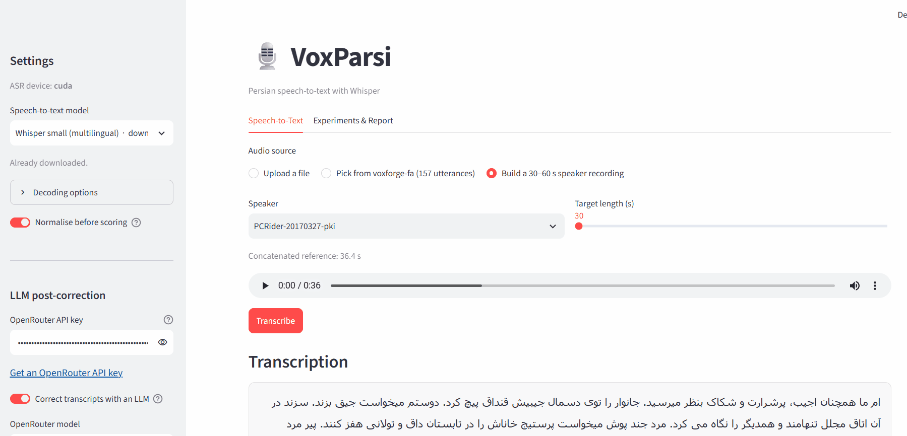

# VoxParsi

VoxParsi is a small Persian speech-to-text application for transcribing audio and evaluating recognition quality. 

## Idea

The application compares a speech recognition result with a known transcript. This makes it possible to measure how well a model handles Persian audio and to compare the original Whisper output with an optional LLM-corrected version.

For longer evaluations, VoxParsi combines recordings from one speaker into a 30–60 second audio file. It combines the corresponding transcripts in the same order, so both Whisper and the LLM output are scored against the correct reference.

## Technology

- Python
- Streamlit for the web interface
- OpenAI Whisper for speech recognition
- PyTorch for model execution
- OpenRouter for optional transcript correction
- WER and CER for evaluation
- Persian speech recordings from the Mozilla Data Collective dataset

Voice cloning is not included in the current version.

## How to use

1. Start the application:

   ```bash
   ./run.sh
   ```

2. Open `http://localhost:8501`.

3. Choose a speech-to-text model in the sidebar.

4. Select one of the following audio sources:
   - Upload an audio file.
   - Select a recording from the local Persian corpus.
   - Build a 30–60 second recording from one speaker's samples.

5. Press **Transcribe**.

6. To evaluate the result, provide or use the displayed reference transcript. The application reports WER and CER.

7. For post-correction, enter an OpenRouter API key, enable LLM correction, and transcribe again. The corrected output is scored against the same reference.

The OpenRouter key can be entered in the sidebar or supplied through the `OPENROUTER_API_KEY` environment variable. The default model is `nvidia/nemotron-3-ultra-550b-a55b:free`.

## Evaluation

- WER (Word Error Rate) measures word-level differences between the reference and the result.
- CER (Character Error Rate) measures character-level differences.
- Lower values indicate a closer match.

Persian and Arabic character variants, punctuation, and spacing are normalized before scoring by default.

## Dataset

The evaluation recordings and transcripts were obtained from the Persian speech dataset on the Mozilla Data Collective:

https://mozilladatacollective.com/datasets/cmp2h1iop00krno07itbxve77

The local corpus is stored in `voxforge-fa/`. Please follow the dataset's terms and attribution requirements when using or redistributing the data.

## Example

The LLM correction is compared with the reference text rather than treated as the ground truth. For example:

**LLM output**

> اما ما همچنان عجیب، پرشرارت و شکاک به نظر می‌رسید. جانوار را توی دسمال جیبش قنداق پیچ کرد. دوستم می‌خواست جیغ بزند. ساکن‌اند در آن اتاق مجلل تنها ماندند و یکدیگر را نگاه می‌کردند. مرد جندپوش می‌خواست پرستیژ خانه‌اش را در تابستان داغ و طولانی حفظ کنند. پیر مرد شروع کرد قطعه‌قطعه زغال‌ها را در آتش انداختن.

**Reference**

> اما همچنان عجیب، پُر شرارت و شکاک به نظر می‌رسید جانور را توی دستمال جیبی‌اش قنداق پیچ کرد دوستم می‌خواست جیغ بزند سه زن در آن اتاق مجلل تنها مانده و همدیگر را نگاه می‌کردند مرد ژنده‌پوش می‌خواست پرستیژ خانه‌اش را در تابستان داغ و طولانی حفظ کند پیرمرد شروع کرد قطعه به قطعه زغالها را در آتش انداختن

## User guide


